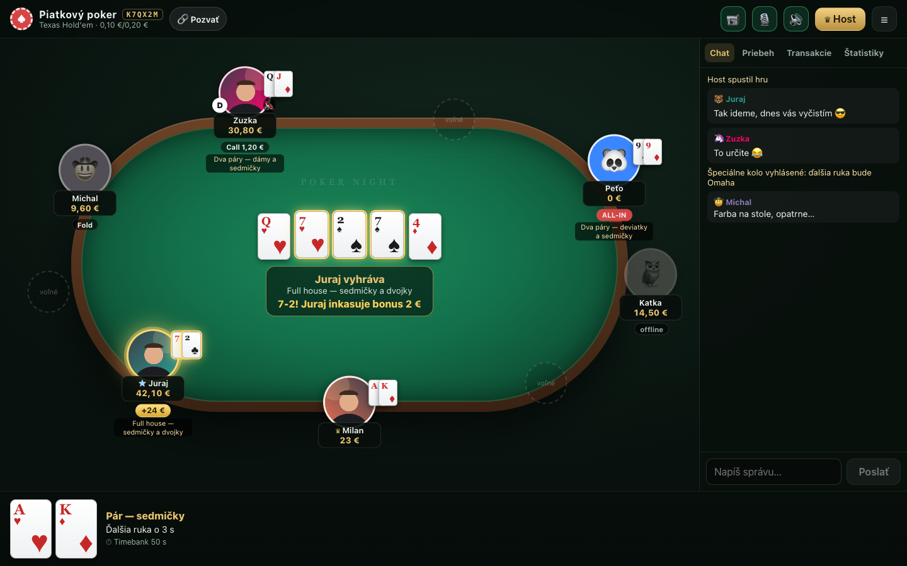
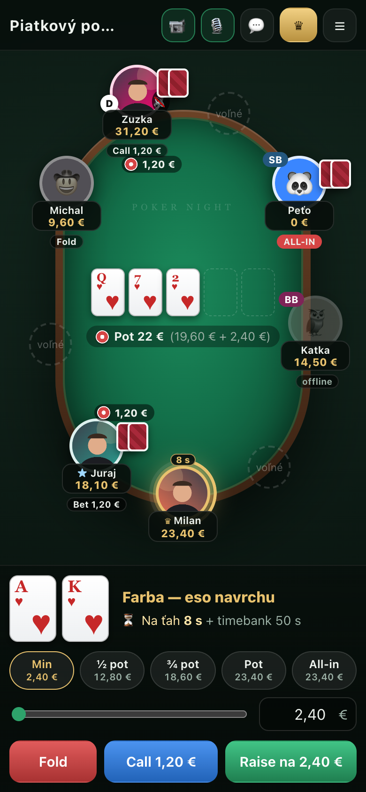
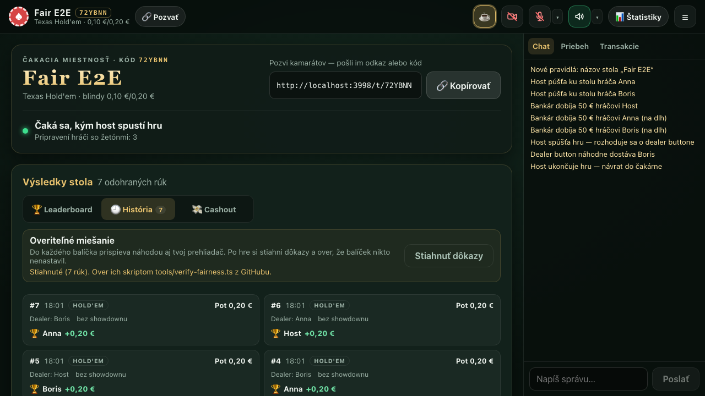

# Poker Night

A private online poker table for a group of friends. The host creates a table and shares a link, and the others take a seat.
It supports Texas Hold'em, Omaha and Pineapple, side pots, run-it-twice, a banker who tracks buy-ins and settles up at the
end, and webcams and microphones peer-to-peer at the table. The UI is in Slovak. Setup, operations and the full feature list
(in Slovak) are in [docs/SETUP.sk.md](docs/SETUP.sk.md), and every screen is shown in [docs/UI.md](docs/UI.md).

| Table (desktop) | Table (phone) |
| --- | --- |
|  |  |



---

# Fairness and trust model

This section is for anyone at the table who wants to check that the game is fair, including the person who runs
the server ("the operator"). It says exactly what is guaranteed, how you can check it yourself, and where you still have
to trust the operator, and why. All of it can be checked against the source code. File references are given so an
independent reviewer (human or AI) can audit each claim.

## Summary

| Question | Answer | How it is ensured |
| --- | --- | --- |
| Can anyone, the operator included, choose or rig the deck? | **No, and you can verify it.** | Commit–reveal shuffle with randomness from every player's browser ([details](#the-shuffle)). |
| Can anyone choose who gets which cards from the deck? | **No, and you can verify it.** | Fixed, published dealing order, checked by the verifier. |
| Can a player see another player's cards? | **No.** | The server sends each player only their own cards. Other players' cards arrive as `null` until they are shown ([`Table.liveView`](server/Table.ts)). |
| Can anyone add chips without everyone seeing it? | **Not secretly.** | Chips change only through the banker, and every change is a public event in the ledger and the chat. A credit counts as a deposit, so it is subtracted from that player's result in the cash-out ([`Table.bankChips`](server/Table.ts), [`shared/settlement.ts`](shared/settlement.ts)). Every stack is visible to the whole table at all times. |
| Can the operator see players' hole cards during a hand? | **Technically yes. This is the one place where you trust the operator.** | See [The trust gap](#the-trust-gap). |
| Is the web page I run the published code? | **You can verify it.** | [`tools/verify-client.ts`](tools/verify-client.ts) compares the files the server sends you with a build of this repository. |

## What the server knows, by design

The server runs the game: it shuffles, deals, validates every action, computes pots and pays winners. Each player receives
only their own cards plus the public information (board, bets, shown hands). Because the server deals, it holds the
complete deck for the hand in memory, and with it every player's hole cards. That is how every server-dealt online poker
game works, including commercial poker rooms.

Since v1.2.0 every player has an account. The server stores the email address, the username, the profile photo and a
`scrypt` hash of the password; login sessions and email links are stored only as SHA-256 hashes. Emails are written to an
outbox and sent by a separate container, so the game server itself never holds the mail password.

## Guarantees you can verify yourself

### 1. Nobody can choose the deck

Before each hand, three things happen in this order:

1. **The players commit.** Each player's browser picks a secret 32-byte random value (its *seed*) and sends the server only
   its SHA-256 hash, the *commitment* ([`client/src/fairness.ts`](client/src/fairness.ts)). The browser always holds one commitment in
   advance for the next hand.
2. **The server commits and freezes the round.** At the start of the pause between hands, the server picks its own secret
   seed and publishes its hash. It also freezes the list of player commitments for this round, sent to every player in
   `table:state` → `fair.round` ([`server/FairDealer.ts`](server/FairDealer.ts) `ensureRound`).
3. **The players reveal.** Only after its browser has *received* that frozen list does it send its seed. The server
   accepts a seed only if its hash equals the commitment ([`FairDealer.reveal`](server/FairDealer.ts)). The browser stores the frozen list
   and its own seed locally *before* sending. That local record is the evidence used later.

The deck is then computed deterministically from the server seed and all player seeds ([the algorithm](#the-shuffle)).
Why this means nobody can rig it:

- The server is bound to its seed before it sees any player seed, so it cannot pick its seed to suit them.
- Every player is bound to their seed before any seed is revealed. Nobody, including the operator playing as a player,
  can pick their seed after seeing the others.
- If at least one player's browser produced its seed honestly, the result is unpredictable to everyone, the server included.
- Every hand has exactly one round (`roundId`). The verifier fails on any round your browser revealed a seed for that
  never became a hand, and on any commitment list that differs from the one your browser saw.

### 2. Nobody can choose who gets which card

Cards come off the top of the deck in a fixed order ([`shared/fairness.ts`](shared/fairness.ts) `expectedDeal`, which
matches [`HandEngine.start`](server/poker/HandEngine.ts) and `dealNextStreet`):

1. Hole cards go one at a time, round-robin, starting from the first occupied seat to the left of the dealer button (seat
   numbers ascending, wrapping around). Hold'em deals 2 rounds, Omaha 4, Pineapple 3.
2. Board: burn 1, flop 3, burn 1, turn 1, burn 1, river 1.
   In a Double Board hand each street is: burn 1, then the top board's cards, then the bottom board's cards (flop 3 + 3,
   turn 1 + 1, river 1 + 1). Run it twice and the rabbit hunt are off in Double Board hands.
3. Extra runs (run it twice or three times) continue from the same deck in the same way, run after run. A paid "rabbit
   hunt" reveals the cards the main board would have received.

The proof records the dealer seat and the seated players, and your browser records what it saw on the table. The
verifier rejects the hand if they differ.

### 3. When a seed is missing

If a committed player's seed does not arrive within 4 seconds (`FAIR_REVEAL_MS`), the hand is dealt without that seed.
This is always public:

- the chat shows "Do miešania neprispeli: …" ("did not contribute to the shuffle"),
- the proof lists the player under `excluded`,
- if your browser *did* send its seed and was excluded anyway, the verifier marks the hand **FAILED** and says so.

## How to verify a game

The server seed of each hand is published only **after the game**: when the host returns the table to the lobby, or 30
minutes after the last hand (`FAIR_REVEAL_IDLE_MS`). Publishing it earlier would let everyone reconstruct the cards their
opponents folded while the game is still going. Once it is published, all hands of that session can be reconstructed,
folded hands included. That is the price of being able to verify them.

1. In the app, open **Štatistiky → História** and click **Stiahnuť dôkazy** ("download proofs"). You get one JSON
   file with your browser's records (the commitment lists it saw, your seeds, your cards, the boards) and the server's proofs.
   Records are kept per browser, so use the browser you played in.
2. Run the verifier from a checkout of this repository. It does not contact the server.

   ```bash
   npm ci
   npx tsx tools/verify-fairness.ts poker-fairness-ABC123-2026-11-03.json
   ```

   For every hand it checks that:
   - the server seed matches the commitment published before the hand;
   - every player seed matches its commitment;
   - the commitment list equals the one your browser saw before revealing;
   - your seed was used;
   - the deck rebuilt from the seeds deals exactly your hole cards, the board, any extra runs, any shown cards and any rabbit hunt.

   Exit code `0` means every published hand verified.
3. Optional: rebuild a deck with the independent Python implementation, which shares no code with the server.

   ```bash
   python3 tools/reference_shuffle.py <table> <roundId> <serverSeed> <playerId>=<seed> ...
   ```

## Verify that your browser runs the published code

The protections above live partly in the browser: it generates your seed and keeps the records. A modified web page could
leak your seed to the server before the round is frozen. To check the page you were served:

```bash
git checkout <commit>           # the version you expect to be deployed
npm ci && npm run build:client
npx tsx tools/verify-client.ts https://poker.example.ts.net
```

Every file of the build is downloaded from the server and compared by SHA-256. The entry page loads scripts only by their
content-hashed file names, so a full match means you ran exactly this code.

The installable app (PWA) changes nothing here. Its service worker ([`client/public/sw.js`](client/public/sw.js)) is one
of the compared files, caches nothing and only handles page loads, to show an offline message when the server is down.
Every load still fetches the page and scripts from the server, so an installed app runs the same code as a browser tab.
The manifest is the only file the server adapts (it writes its own address into the app's `related_applications` entry,
[`shared/manifest.ts`](shared/manifest.ts)), and the verifier applies the same change to the local build before comparing.

## The trust gap

**During a hand, the operator could read every player's hole cards and the rest of the deck from the server's memory, or
run modified server code that does.** Nothing in this repository can prevent that, and no setting turns it off. The
operator has full control of the machine the server runs on.

### Why it is built this way

- It follows from the server dealing the cards, as every online poker room does. The only way to stop the dealer seeing
  the cards is to remove the dealer: ["mental poker"](https://en.wikipedia.org/wiki/Mental_poker) protocols encrypt the
  deck with keys held by every player, so a card can only be opened when all the others cooperate.
- This project deliberately does not use mental poker, for three reasons:
  - **Every player must answer for every card.** Every player must stay online and respond to deal each card. One player's
    Wi-Fi dropping would freeze or void the hand for everyone.
  - **The client must come from somewhere else.** Players would have to load the client from a source the operator does
    not control. Otherwise the operator could serve a page that leaks the keys, and the protection would be only apparent.
  - **Much more complexity.** It needs far more complex cryptography and game code, which means more room for real bugs at
    a friendly game.
- The other approach is hardware that proves which code a server runs (remote attestation). The home server this game runs
  on has no such hardware. A "version hash" reported by the server proves nothing, because a modified server can report
  any hash.

### What it still limits

The operator cannot use this gap to change the deck or the dealing without it being detected:

- the deck and the dealing are verifiable;
- every action, pot and chip change is visible to the whole table as it happens.

The gap is information: knowing other players' cards while playing.

## Other limits, stated plainly

- **Collusion between players** (sharing cards over the phone) is outside what any software can stop.
- **Withholding a seed.** A player who withholds their seed is excluded, publicly. The operator, who knows the server seed,
  could therefore choose between two decks for a hand: one with their own seed and one without. Each such choice is publicly
  visible as an exclusion of their seed. Excluding another player's seed is flagged by that player's verifier.
- **Discarded rounds.** An honest server never throws a round away once seeds are revealed: the round is saved and the
  next hand uses it, even after a restart (browsers then re-send their seed). A discarded round would let the server
  shuffle again until it liked the deck, so the verifier fails on every round your browser revealed a seed for that never
  became a hand, and on every hand you saw that has no proof. A server crash in the first second of a round, before it was
  saved, can cause one such failure without any cheating.
- **Hands nobody contributed to.** If no browser contributed (for example, the page was opened over plain `http://` on a
  LAN address, where browsers do not provide SHA-256 to pages), the deck depends only on the server seed. The verifier
  reports "No player contributed a seed" for such hands.
- **Other uses of server randomness** are not covered by the proofs: the card draw for the first dealer button, random seat
  assignment and table codes. They use the operating system's cryptographic random number generator (`crypto.randomInt`).
- **The hand in progress during a server restart** is cancelled and every player gets back the chips they had before it.
  Its proof stays in the list.
- **Your own records stay in your browser** (`localStorage`). A different device or cleared site data means the verifier
  can still check the seeds and the deck, but not "what you saw", for those hands.
- **`verify-client` proves what the server sent to you.** A server could in theory send different files to different
  visitors.

## The shuffle

All of this is in [`server/poker/fairDeck.ts`](server/poker/fairDeck.ts), which has about 60 lines of logic.

- **Seeds and commitments.** A seed is 32 random bytes, written as 64 lowercase hex characters. Its commitment is
  `SHA-256(seed bytes)`, also as hex.
- **Key.**
  `K = SHA-256( "poker-night/shuffle/v1" ‖ 0x00 ‖ tableCode ‖ 0x00 ‖ roundId ‖ 0x00 ‖ serverSeed[32 bytes]
  ‖ for each contributing player, sorted by playerId: playerId ‖ 0x00 ‖ seed[32 bytes] )`.
  Strings are UTF-8, and player IDs are ASCII UUIDs sorted by plain string comparison.
- **Random stream.** Block `i` is `HMAC-SHA256(K, uint32_be(i))` for `i = 0, 1, 2, …`. Each block gives eight `uint32`
  words, read big-endian in order.
- **Unbiased range.** `below(n)` takes the next word `w`, skips it while `w ≥ 2³² − (2³² mod n)`, and returns `w mod n`.
- **Starting deck.** The 52 cards are ordered by suit, then rank: suits `s h d c`, and within each suit the ranks
  `2 3 4 5 6 7 8 9 T J Q K A`, so the deck reads `2s 3s … As 2h … Ac`.
- **Fisher–Yates.** For `i = 51` down to `1`: `j = below(i + 1)`, then swap positions `i` and `j`. Position 0 is the top
  of the deck.

**Test vector.** Inputs: table `ABC123`, round `0011223344556677`, server seed `01` × 32 bytes, and seeds
`player-a` = `02` × 32 and `player-b` = `03` × 32. The deck starts `3d 2s 9c Jd Kh Ad Kc 2h 3h 8d`. The commitment of the
server seed is `72cd6e8422c407fb6d098690f1130b7ded7ec2f7f5e1d30bd9d521f015363793`. Both values are checked by the
tests ([`server/test/fairness.test.ts`](server/test/fairness.test.ts)), which also compare the server code with a second
implementation written from this description. `python3 tools/reference_shuffle.py` prints the same deck.

## Where to look (audit map)

| File | What to check |
| --- | --- |
| [`server/poker/fairDeck.ts`](server/poker/fairDeck.ts) | Key derivation, random stream, rejection sampling, shuffle. |
| [`server/FairDealer.ts`](server/FairDealer.ts) | Round lifecycle: commit, freeze, reveal (hash check), deal, proof, and the seed being withheld until after the game. |
| [`server/Table.ts`](server/Table.ts) | `fairReady` / `startHand`: a hand waits for seeds and uses the round's deck. `fairProofs`: when seeds are published. `liveView`: which cards each player receives. |
| [`server/poker/HandEngine.ts`](server/poker/HandEngine.ts) | Deals strictly from the top of the given deck (`draw`), in the order described above. |
| [`client/src/fairness.ts`](client/src/fairness.ts) | Seed generation (`crypto.getRandomValues`), commit before reveal, local records written before the seed is sent. |
| [`server/poker/fairVerify.ts`](server/poker/fairVerify.ts), [`tools/verify-fairness.ts`](tools/verify-fairness.ts) | What the verifier checks and when it fails. |
| [`server/index.ts`](server/index.ts) | Every socket event a client can send. There is no admin or debug endpoint that exposes cards. |

Suggested prompt for an AI reviewer: *"Read README.md (Fairness and trust model) and the files in the audit map. Find any
way the server operator or a player could influence the deck, the dealing, or chip counts without it being detected by
`tools/verify-fairness.ts` or being visible to the table, and check whether the README's description of the trust gap is
complete and accurate."*
